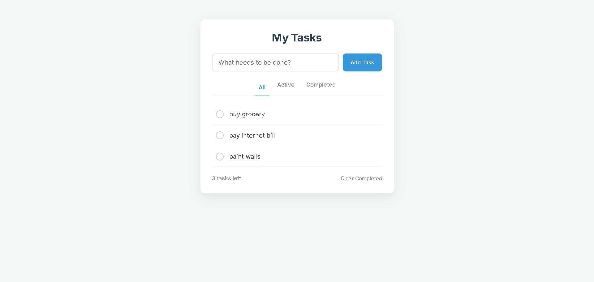

# Task Manager (To-Do App)


A fully functional, modern Task Manager application built with Vanilla JavaScript. This is Project 3 of my 10-project developer portfolio series.



## 🚀 Live Demo

**[View the Live Website Here](https://delightful-pithivier-03d34d.netlify.app)**

## 📖 About The Project

The Task Manager is a single-page application designed to help users organize their daily activities. 

The primary goal of this project was to demonstrate a deep understanding of **CRUD (Create, Read, Update, Delete) operations** and **data persistence**. The application saves all tasks to the browser's `localStorage`, meaning the user's data remains intact even after refreshing the page or closing the browser.

## ✨ Key Features

*   **Full CRUD Functionality:** Users can add new tasks, view them, mark them as complete/incomplete, and delete them.
*   **Data Persistence:** Utilizes `localStorage` to save tasks locally in the browser, ensuring no data is lost on refresh.
*   **Dynamic Filtering:** Users can filter tasks by "All", "Active", or "Completed" using JavaScript array methods.
*   **Event Delegation:** Efficiently handles click events for dynamically generated elements (like the delete button and checkboxes) using a single event listener on the parent container.
*   **Interactive UI:** Features smooth animations, hover effects, and a custom-styled checkbox for a modern user experience.
*   **Clean Architecture:** Code is organized into logical functions (`addTask`, `renderTasks`, `saveTasks`) for maintainability.

## 🛠️ Tech Stack

*   **HTML5:** Semantic structure and accessibility.
*   **CSS3:** Custom properties, Flexbox, keyframe animations, and custom form control styling.
*   **Vanilla JavaScript (ES6+):** 
    *   Array methods: `.push()`, `.filter()`, `.find()`
    *   Local Storage API
    *   Event Delegation
    *   DOM Manipulation

## ⚙️ How to Run Locally

1. Clone the repository:
   ```bash
   git clone https://github.com/waseemqureshi2020/task-manager.git